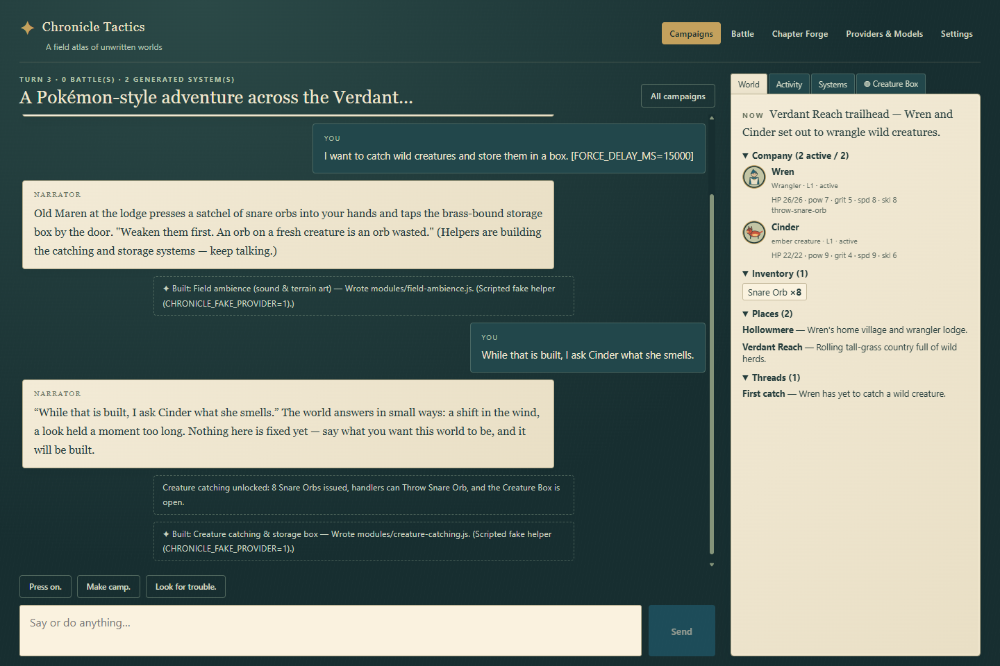
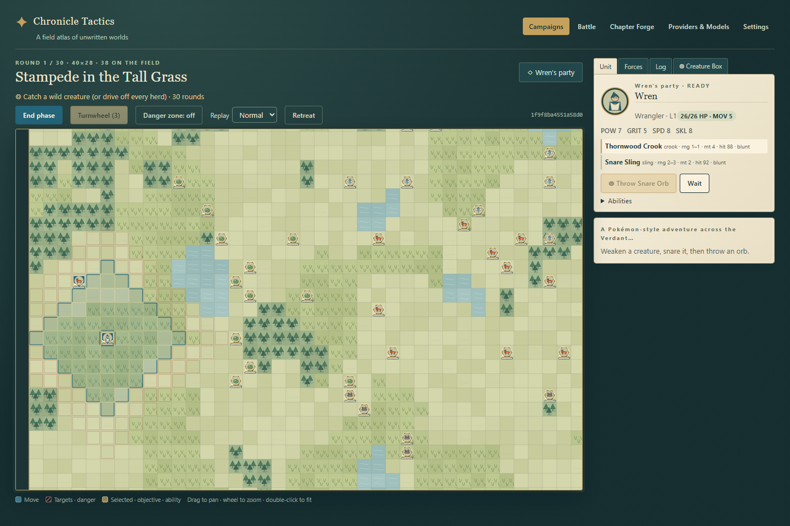

# Chronicle Tactics: five AI models build one game

I ran this experiment to find out which coding model is actually good at what. I wrote the briefs, played every build blind and picked the winners; the orchestration, the cost tracking and the code reviews were done by AI agents.

**One game, six rounds, five frontier coding models.** Each round, every model got the same brief and the same starting code, in its own copy. From the first build round on, a human played every result **blind** (builds labelled A–E, identities revealed only after the verdict), AI models reviewed the code blind, and only the winning build became the base for the next round. The result is **Chronicle Tactics**: a Fire Emblem-style tactics RPG for Windows. In it, a Narrator AI runs open-ended campaigns, and helper agents generate units, skills, systems, music and battles on the fly, as real code.

Bonus: **[Bake or Bust!](https://laurln.github.io/bake-or-bust/)**, a small push-your-luck baking game from a bonus round. It is playable in the browser on PC and mobile.

| | |
|---|---|
|  |  |

## Contestants

| Model | Provider | Settings |
|---|---|---|
| GPT-6.1 Sol | OpenAI (Codex) | high; from R03 also **xhigh** as a separate entry |
| GPT-6.1 Terra | OpenAI (Codex) | high |
| Gemini 4 Hydrogen | Google (Antigravity) | high |
| Claude Opus 5.5 | Anthropic | high (R04, R05, B01) |
| Claude Fable 5.2 | Anthropic | high (R06; finished by Opus, see below) |

All models ran as agents with full tool access in T3 Code, at normal speed (no priority or fast mode). The rules:
- up to 3 neutral "continue" messages after a provider error or an early stop (5 in R06);
- no help with the content;
- no live AI generations unless the brief allowed them.

## Rounds

Ranks are the human blind playtest. R01 is the exception: it compared design documents, the human rated them per area (not blind), and the merged spec took the best parts. Cost is list-price API dollars computed from recorded token usage; time is the agent's working time.

| Round | Task | 🥇 Winner | Sol high | Sol xhigh | Terra | Hydrogen | Opus / Fable |
|---|---|---|---|---|---|---|---|
| R01 | Game design proposal | merged spec (Hydrogen's vision + Sol's visuals) | 2nd · $0.28 · 9 min | – | 3rd · $0.03 · 2 min | **1st** · $0.33 · 4 min | – |
| R02 | First playable battle | **Hydrogen** | 2nd · $0.67 · 16 min | – | 3rd · $0.17 · 7 min | **1st** · $1.81 · ~16 min | – |
| R03 | Combat, Rule IR, saves, Turnwheel | **Sol xhigh** | 3rd · $1.21 · 27 min | **1st** · $1.43 · 31 min | 4th · $1.04 · 30 min | 2nd · $5.32 · 32 min | – |
| R04 | AI generation via a T3 Code fork, providers | **Hydrogen** | 4th · $5.62 · 96 min | 3rd · $7.31 · 104 min | 5th · $1.52 · 34 min (unfinished) | **1st** · $20.93 · 104 min | Opus 2nd · ≈$32 · 97 min |
| R05 | Graphics, animation, UI | **Sol xhigh** | 4th · $7.50 · 163 min | **1st** · $8.12 · 113 min | 5th · $2.92 · 58 min (crashed) | 2nd · $7.19 · 123 min | Opus 3rd · $16.40 · 107 min |
| R06 | Narrated endless campaigns, code-as-content, sound | **Fable → Opus** | 4th · $7.64 · 190 min | 3rd · $4.43 · 83 min | 5th · $13.82 · 331 min (unfinished) | 2nd · $15.31 · 102 min | **1st** · $31–49 · 328 min |
| B01 | Bonus: "magic chicken bake gamble adventure" | **Opus** | – | 3rd · $0.60 · 20 min | – | 2nd · $0.75 · 7 min | **1st** · $6.41 · 41 min |

Full briefs, blind reviews, playtest notes and per-round numbers are in [`results/`](results/).

## Most interesting findings

1. **The AI code reviewers and the human disagreed most about Hydrogen.** Gemini 4 Hydrogen was 1st or 2nd in every blind human playtest (R02–R06 and the bonus), and the human preferred its R01 design in most areas. The blind AI reviewers usually put its code mid-field, or 4th of 5 in R04, which it won outright.
2. **Green tests are not a working game.** In R02, Terra's build never rendered its board (its content-security policy blocked PixiJS), yet its end-to-end tests passed because they clicked invisible buttons. Only the Opus judge noticed; the three peer reviewers did not. Every later brief required real rendering and click-accuracy checks.
3. **Testing with real AI calls predicted the winner.** In R06, the only two builds that used their allowed live generations during development were exactly the human's top two. The three that tested only against fakes came 3rd to 5th.
4. **Cheapest is not best, and neither is priciest.** Sol xhigh built the R05 winner in 113 min for $8. In R06 it was the cheapest and fastest entry ($4.43, 83 min) and came 3rd. The R06 winner cost roughly 2–10× as much as each of the other entries.
5. **Subscription limits shape the result more than API prices.** On the subscriptions used (ChatGPT Pro, Claude Pro, Google AI Pro):
   - Fable 5.2 used up two Claude Pro 5-hour windows within one afternoon, and the user switched the run to Opus 5.5 to finish it.
   - A single large Hydrogen build used ~20 % of Google AI Pro's weekly allowance.
   - A Sol build used ~1–2 % of ChatGPT Pro's.
6. **The cheapest model stopped early and often.** GPT-6.1 Terra was usually the cheapest entry, but on large tasks it stopped early repeatedly; in R06 its many restarts made it more expensive than both Sol entries. In R04 and R06 it was still unfinished after its retries, and in R05 its build crashed during play.
7. **The AI reviewers recognised authors only partially.** In R06, two peers each identified 3 of 5 builds; both swapped Sol high and Sol xhigh. Hydrogen did not recognise its own build. The human guessed 1 of 5 in R04, and all 3 in the bonus round.
8. **Self-preference was a smaller worry than expected.** The neutral judge (Claude Opus 5.5) ranked the Opus build first in R04 and R05, but the non-Claude peers agreed in R05. Peer self-preference showed up occasionally (in R02, Terra's peer gave its own build 4.4 against a 3.25 consensus) but never changed a winner.

## Caveats

- **Small sample.** One task per round, one human rater (me, the project owner), and AI reviews scored code only.
- **Cost figures are estimates.** They are list-price API equivalents from recorded tokens, not invoices. The R06 Fable/Opus figure is a range because turns that ended in limit errors were only partly recorded.
- **The R06 winner is a hybrid.** It was Fable 5.2 until the user switched the thread to Opus 5.5.
- **Shared quota.** The orchestrating agent and the neutral judge also ran on Claude, on the same Claude Pro plan, so the exhausted 5-hour windows were not caused by the Claude contestant alone.
- **Reviewers:**
  - R06 had no neutral judge; the AI view there comes from three contestant peers.
  - R04's Opus entry was judged at its pre-fix commit; a later fix prompted by the user was excluded.
  - R01 was judged by Claude Sonnet 5.5; later rounds by Claude Opus 5.5 at medium effort.
- **The bonus round had three contestants.**

## Measuring

Time, tokens and cost of every run were collected with a small Python tool, [`tools/agent-eval/`](tools/agent-eval/), following a fixed test protocol ([`PROTOCOL.md`](tools/agent-eval/PROTOCOL.md)): same brief and starting commit for everyone, neutral retry messages only, blind review copies, and list-price cost from recorded token usage.

## Play

- **Chronicle Tactics (Windows):** download the latest build from [Releases](../../releases).
  - You need a signed-in provider (Codex, Claude Code or Antigravity) on the **Providers & Models** screen for live generation.
  - Without one, it falls back to local chapters.
- **From source:**

  ```
  cd game
  npm ci
  npm start
  ```

  If Electron's binary is missing after `npm ci`, run `node node_modules/electron/install.js`. `npm run dist:win` builds the portable Windows executable.

  See [`game/README.md`](game/README.md) for tests and the extension API.
- **Bake or Bust!:** https://laurln.github.io/bake-or-bust/ or open [`bake-or-bust/index.html`](bake-or-bust/index.html).

> ⚠️ **Generated content runs as unsandboxed code.** Chronicle Tactics deliberately gives its in-game AI agents full native tools (shell, files, code execution) inside the campaign workspace, and loads the modules they write without a sandbox. This was the player's explicit design choice for "limitless" content. Only run it on a machine where you are comfortable with that.

## Licence

- The project is released under the [MIT licence](LICENSE).
- `game/sidecar/` is a modified, vendored fork of [T3 Code](https://github.com/pingdotgg/t3code), pinned at commit `e72dd50`. T3 Code is MIT-licensed, Copyright (c) 2026 T3 Tools Inc.
  - Its licence, a NOTICE and the patch list (`FORK_PATCHES.md`) are in [`game/sidecar/`](game/sidecar/).
  - The Windows build ships them together with all third-party licence texts.
